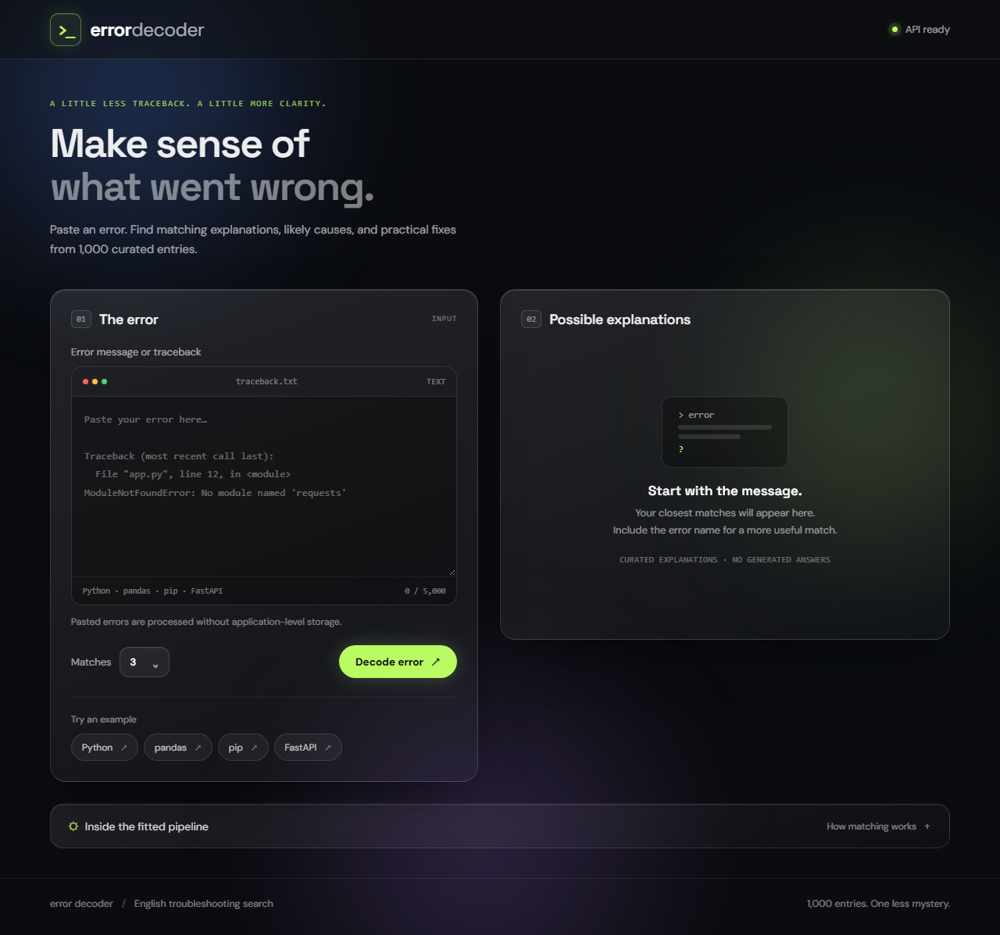
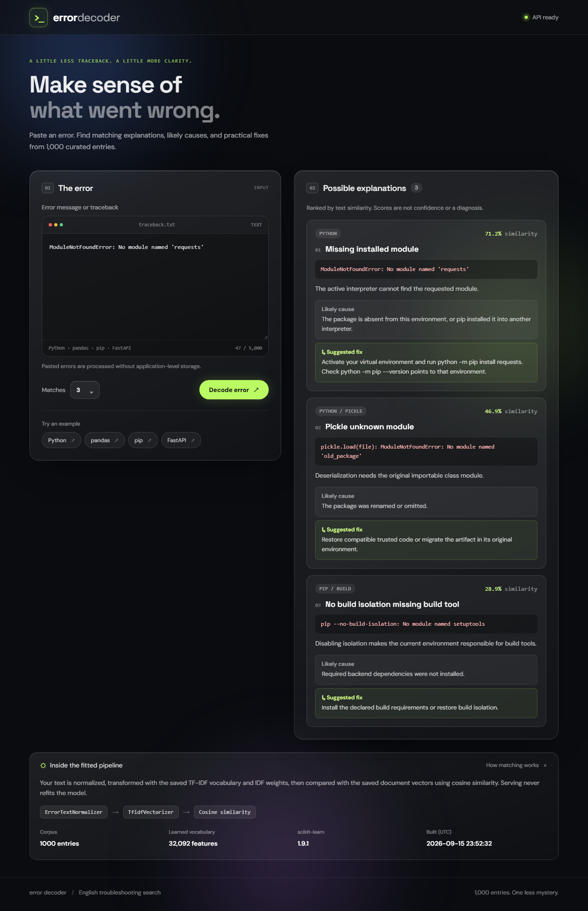
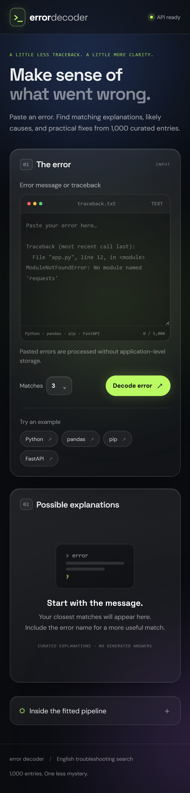

# Error Decoder

### Make sense of what went wrong.

Paste a programming error and find matching explanations, likely causes, and practical fixes from **1,000 curated troubleshooting entries**.

**[Launch the finished app →](https://error-decoder-orpin.vercel.app/)** · [API documentation](https://juanthom99--error-decoder-api.modal.run/docs) · [API health](https://juanthom99--error-decoder-api.modal.run/health)

The live app is public and requires no account. This repository contains its source code, fitted model, and project evidence.

[](https://error-decoder-orpin.vercel.app/)

## What it does

Error Decoder searches a curated knowledge base covering **Python, pandas, pip, and FastAPI**. Each result includes an example error, an explanation, its likely cause, and a suggested fix.

- **Practical results:** choose one to five matches, ranked by text similarity.
- **Transparent matching:** inspect the saved pipeline, vocabulary size, and model version directly in the app.
- **Responsive interface:** a dark glass design with mobile layouts, keyboard controls, and reduced-motion support.
- **Clear empty states:** unsupported vocabulary returns a no-match explanation instead of an invented answer.
- **No generated answers:** results come from the curated corpus. Application code does not store submitted errors.

## Try it

1. Open the **[live application](https://error-decoder-orpin.vercel.app/)**.
2. Paste an error, or select a built-in example.
3. Choose the number of matches and select **Decode error**.
4. Review the explanation, likely cause, and suggested fix. Expand **Inside the fitted pipeline** to see how matching works.

For example, try:

```text
ModuleNotFoundError: No module named 'requests'
```

The API may take a moment to start after being idle.

## Screenshots

### Search results

A real example search returns ranked explanations and practical troubleshooting steps.



<details>
<summary><strong>View the mobile interface</strong></summary>

<br>



</details>

Screenshots are captured application views included with the project. See the [screenshot guide](evidence/SCREENSHOT_GUIDE.md) for capture details and additional states.

## How it works

```text
React frontend on Vercel
          │
          ▼
FastAPI API on Modal
          │
          ▼
ErrorTextNormalizer → saved TF-IDF vocabulary → cosine similarity
          │
          ▼
Ranked entries with explanations and suggested fixes
```

The custom `ErrorTextNormalizer` standardizes traceback locations, URLs, memory addresses, case, and whitespace while preserving useful error terms. An offline training script fits the scikit-learn pipeline and saves it with the document vectors, corpus, and metadata.

FastAPI loads the artifact once at startup. Searches use the saved vocabulary and IDF weights; serving does not refit the model.

| Component | Technology |
| --- | --- |
| Interface | React, Vite, CSS |
| API | FastAPI, Pydantic |
| Retrieval | scikit-learn TF-IDF and cosine similarity |
| Saved model | joblib |
| API hosting | Modal |
| Frontend hosting | Vercel |
| Verification | pytest, Playwright, Postman |

The included artifact uses **scikit-learn 1.9.1** and **32,092 learned features**. The corpus contains 350 Python, 250 pandas, 175 pip, and 225 FastAPI entries.

## Run locally

Prerequisites: **Python 3.14**, **Node.js 22.12 or later**, and access to this repository. Commands below use PowerShell and run from the project root.

### Backend

```powershell
python -m venv .venv
.venv/Scripts/python -m pip install -r requirements-dev.txt
.venv/Scripts/python -m uvicorn serve:app --host 127.0.0.1 --port 8000
```

The fitted `pipeline.joblib` is included. To rebuild the corpus and artifact:

```powershell
.venv/Scripts/python create_entries.py
.venv/Scripts/python build_pipeline.py
```

Keep the artifact, `artifact-metadata.json`, and pinned dependencies together. Only load trusted joblib artifacts.

### Frontend

In a second terminal:

```powershell
cd frontend
npm.cmd ci
npm.cmd run dev
```

Open **http://127.0.0.1:5173**. Development defaults to the local API at port 8000. For another API, set `VITE_API_BASE_URL` before starting or building the frontend.

## API

**Base URL:** [https://juanthom99--error-decoder-api.modal.run](https://juanthom99--error-decoder-api.modal.run/)

| Endpoint | Purpose |
| --- | --- |
| `GET /health` | Readiness; returns 200 when the artifact is available |
| `GET /pipeline-info` | Fitted pipeline metadata and ranking method |
| `POST /search` | Search using `text` and optional `top_k` |
| `GET /docs` | Interactive API documentation |

Example request body:

```json
{
  "text": "ModuleNotFoundError: No module named 'requests'",
  "top_k": 3
}
```

Text must contain 1–5,000 characters, and `top_k` must be an integer from 1–5. Invalid input returns **422**. Unknown vocabulary returns **200** with an empty result list. An unavailable or incompatible artifact returns **503** for readiness and search operations.

## Tests and project evidence

The included verification records report **58 passing backend tests**, **12 passing browser tests**, and a Postman run with **10 requests and 25 passing assertions**. These are saved project results, rather than a continuously updated build status.

```powershell
# Backend checks, from the project root
.venv/Scripts/python -m pytest -q

# Browser checks against the deployed application
cd frontend
$env:FRONTEND_URL='https://error-decoder-orpin.vercel.app'
$env:API_BASE_URL='https://juanthom99--error-decoder-api.modal.run'
npx.cmd playwright test
```

- [Verification details](VERIFICATION.md)
- [Postman collection](postman/Error-Decoder.postman_collection.json)
- [Postman report](evidence/postman-run.html)
- [Valid search screenshot](evidence/screenshots/postman-05-valid-search-200.png)
- [Invalid input screenshot](evidence/screenshots/postman-06-invalid-search-422.png)

## Repository guide

| Path | Contents |
| --- | --- |
| `frontend/` | React interface, styling, and browser tests |
| `serve.py` | FastAPI application and input validation |
| `pipeline_def.py` | Custom text normalizer |
| `build_pipeline.py` | Offline pipeline fitting and artifact creation |
| `pipeline.joblib` | Saved fitted pipeline and search data |
| `corpus/` and `entries.json` | Editable corpus sources and compiled entries |
| `modal_serve.py` | Modal deployment |
| `postman/` | API collection and assertions |
| `tests/` | Backend tests |
| `evidence/` | Screenshots and saved verification reports |

## Deployment

The frontend deploys from `frontend/` on Vercel. Set `VITE_API_BASE_URL` to the public Modal API URL before building.

The backend deploys with `modal deploy modal_serve.py`. Its image includes the API, custom transformer, fitted artifact, metadata, and exactly pinned dependencies. Set `CORS_ORIGINS` to the frontend's allowed HTTPS origin.

[Deployment URLs](DEPLOYMENTS.json) · [Modal ASGI guide](https://modal.com/docs/guide/webhooks) · [Vite on Vercel](https://vercel.com/docs/frameworks/frontend/vite)

## Scope and limitations

Matching scores measure text similarity, not confidence that a fix is correct. The English-language corpus covers selected troubleshooting patterns and is not a complete programming reference. Self-match tests measure consistency rather than real-world accuracy. Hosting providers may retain operational logs even though the application does not store search text.

See [corpus notes](CORPUS_NOTES.md) for sources and evaluation boundaries.

---

Built by **Juan Thomas**.
